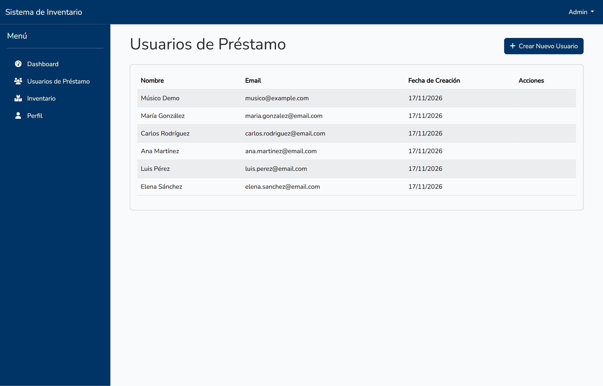
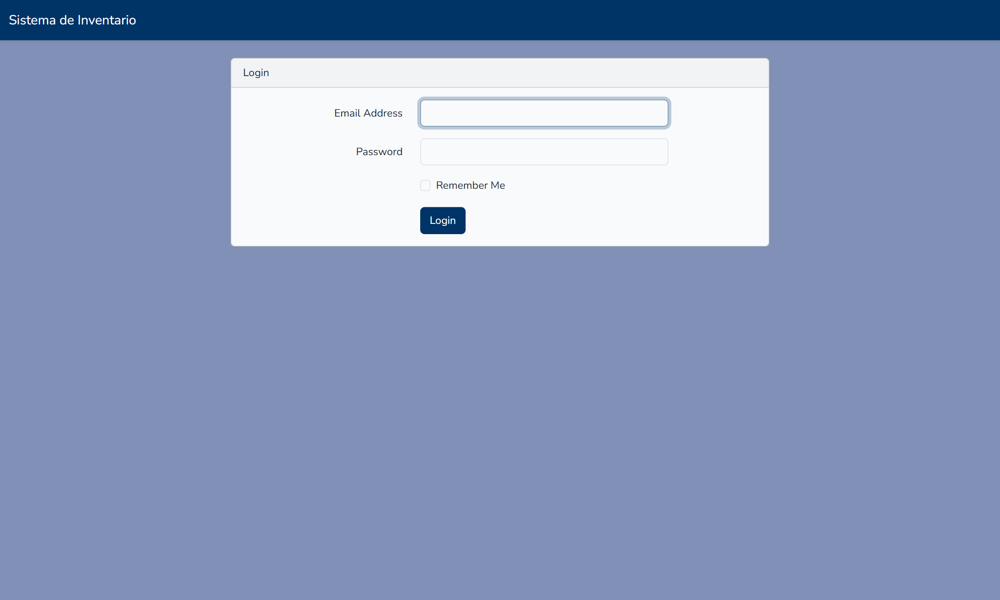
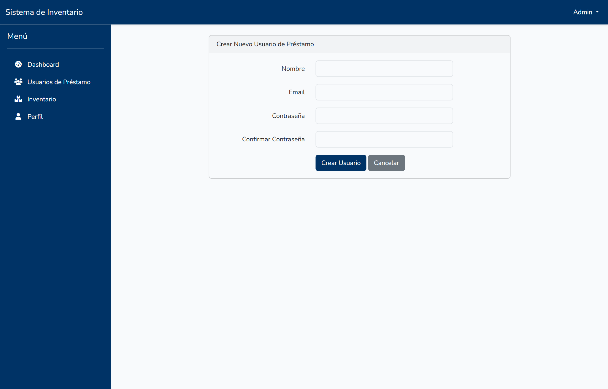
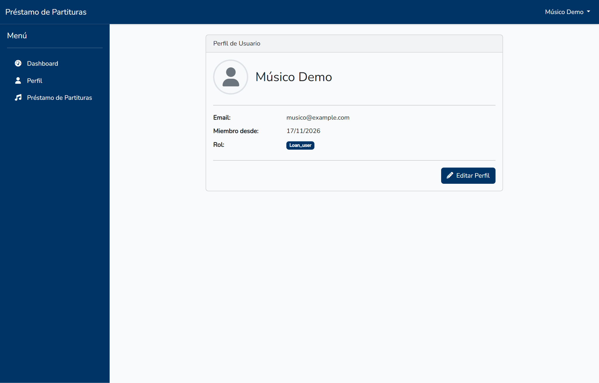

# Music Score Inventory & Loan System 🎼

A web application to manage the **physical sheet-music library** of a musical institution (orchestra / music school). Librarians keep a catalog of works, scores and the shelves where they are stored, and musicians request scores on loan from their own account — so the institution always knows who has each score and how many copies are left.

Built as a **community service project** (*servicio comunitario*) with Laravel 12.



## ✨ Features

- **Two roles with separate areas**
  - **Admin (librarian):** manages loan users, inventory and loan requests.
  - **Loan user (musician):** sees available scores, requests loans and checks their own loan history.
- **Role-based access** with a custom `CheckAdmin` middleware and role-aware redirect after login.
- **Catalog model** covering the real structure of a music library:
  works (`Obra`), authors (`Autor`) and their contribution type (composer, arranger…), scores (`Partitura`), shelves (`Estante`), inventory per instrument (`Inventario`) and loans (`Prestamo`).
- **Inventory with quantities per instrument and shelf**, with a unique constraint to avoid duplicate entries.
- **Loan workflow:** musicians request a score + instrument + quantity; admins approve or reject pending requests.
- **Inventory tables with search and export** to Excel, PDF and print.
- **User profile** with photo, editable data and role badge.
- Registration and password reset are disabled — accounts are created by the admin.

## 📸 Screenshots

| Login | Create loan user |
|---|---|
|  |  |
| **Loan users (admin)** | **Musician profile** |
|  |  |

> Screenshots use the demo data from the seeders.

## 🛠️ Tech Stack

- **Backend:** PHP 8.2+, Laravel 12, Eloquent ORM, Laravel UI (auth scaffolding)
- **Frontend:** Blade, Bootstrap 5, Sass, Vite, vanilla JS
- **Database:** SQLite by default (MySQL / PostgreSQL supported through `.env`)
- **Tooling:** Composer, Artisan, migrations & seeders, PHPUnit

## 🗄️ Data Model

```
Autor ──< Contribucion >── Obra ──< Partitura ──< Inventario >── Estante
                │                                     │
        TipoContribucion                          Prestamo >── User (role: admin | loan_user)
```

- An **Obra** (work) can have several authors, each with a **TipoContribucion** (composer, arranger, lyricist…).
- A **Partitura** (score) belongs to a work; its copies live in **Inventario** rows, one per instrument and **Estante** (shelf), with a quantity.
- A **Prestamo** (loan) links a user to an inventory item with a quantity and a status.

## 🚀 Getting Started

**Requirements:** PHP 8.2+ (extensions: `pdo_sqlite`, `mbstring`, `openssl`, `fileinfo`), Composer, Node.js 18+.

```bash
git clone https://github.com/maferCachopo/servicio_comunitario.git
cd servicio_comunitario

composer install
npm install
npm run build

cp .env.example .env          # Windows: copy .env.example .env
php artisan key:generate
```

Create the SQLite database and load the demo data:

```bash
# macOS / Linux
touch database/database.sqlite
# Windows (PowerShell)
New-Item database/database.sqlite

php artisan migrate --seed
php artisan serve
```

Open <http://127.0.0.1:8000>.

### Demo account

| Role | Email | Password |
|---|---|---|
| Admin | `admin@example.com` | `123456` |

The seeders also create sample authors, works, scores, inventory and loan users.

### External inventory API

The inventory tables, the loan-request form and the creation of loan users call a companion REST API at `http://127.0.0.1:8050/api/v1` (see `app/Http/Controllers/InventoryController.php`, `LoanUserController.php` and `resources/js/loan-request.js`). That service is **not included in this repository**; without it those screens load without data. Login, the loan-user list, profiles and role-based navigation work on their own.

## 📁 Project Structure

```
app/
├── Http/Controllers/   HomeController, InventoryController, LoanUserController, ProfileController, Auth/
├── Http/Middleware/    CheckAdmin (admin-only routes)
└── Models/             Autor, Contribucion, Estante, Inventario, Obra, Partitura, Prestamo, TipoContribucion, User
database/
├── migrations/         Library schema (authors, works, scores, shelves, inventory, loans)
└── seeders/            Admin user + demo catalog
resources/
├── views/              Blade views (auth, inventory, loan_users, loan_request, profile)
└── js/loan-request.js  Loan request modal and history
routes/web.php          Web routes + internal JSON endpoints
```

## 👤 Author

**María Fernanda Cachopo Rojas** — Computer Engineering student · Full Stack Developer
📫 [mafecaro2000@gmail.com](mailto:mafecaro2000@gmail.com)
